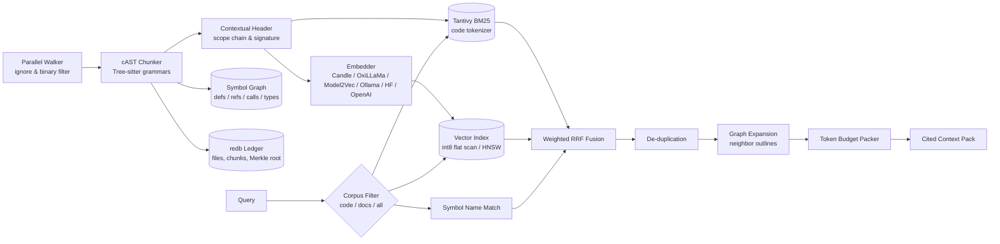

# dendrite-rag-rs

[](Cargo.toml)
[](Cargo.toml)
[](Cargo.toml)

A retrieval engine purpose-built for source code repositories and technical documentation. Designed for AI coding assistants and autonomous developer agents, `dendrite-rag-rs` solves the dual challenges of retrieval accuracy and token efficiency:

- **Syntax-Aware Chunking (cAST)**: Uses Tree-sitter to split code along semantic boundaries (functions, classes, impl blocks, markdown sections) rather than arbitrary line windows. Each chunk preserves its qualified scope chain, signature, and doc comments.
- **Code-Aware BM25**: Employs [Tantivy](https://github.com/quickwit-oss/tantivy) with a specialized `CodeTokenizer` that indexes whole identifiers as well as components split across `camelCase`, `snake_case`, and numbers.
- **Pluggable Vector Embeddings**: In-process inference via [Candle](https://github.com/huggingface/candle) (Metal/CUDA/CPU), [OxiLLaMa](https://github.com/yasuomaidana/oxillama) (GGUF), [Model2Vec](https://github.com/MinishLab/model2vec), local Ollama, Hugging Face TEI, and OpenAI-compatible gateways.
- **Quantized Vector Search & HNSW**: Dot-product int8 flat scan with exact float rescoring, plus an optional Hierarchical Navigable Small World (`hnsw` feature) graph index.
- **Typed Symbol Graph & Leiden Communities**: Extracts call, import, and type reference edges, and runs the Leiden algorithm to detect semantic code communities.
- **Weighted Reciprocal Rank Fusion (RRF)**: Merges sparse BM25, dense embedding vectors, and symbol matches into a single unified ranking without score calibration issues.
- **Token-Budgeted Context Packs**: Assembles prompt-ready context spans with `path:line` citations, eliminates duplicate code blocks, and outlines oversized definitions to strictly fit LLM token budgets.
- **Incremental & Local-First**: Maintains index state in an embedded [redb](https://github.com/cberner/redb) ledger inside the repository (`.dendrite/rag` or `.loom`), with SQLite available as an opt-in ledger (`sqlite` feature, `[storage] ledger = "sqlite"`). Uses BLAKE3 Merkle tree diffing (`embedag-core`) to skip unchanged files and never recompute embeddings for identical chunks.

---

## Workspace Layout

The repository is organized as a Cargo workspace with three specialized crates:

```text
dendrite-rag-rs/
├── crates/
│   ├── loom-rag/       # Core retrieval engine library (Rust, independent of Dendrite)
│   ├── dendrite-rag/   # Sidecar daemon (JSON-RPC 2.0 stdio) and developer CLI
│   └── loom-eval/      # Statistical benchmarking suite and baseline comparison harness
├── docs/               # System architecture and specifications
├── proto/              # JSON-RPC 2.0 protocol JSON schemas
└── eval/               # Golden query sets and benchmark reports
```

| Crate | Type | Documentation | Description |
|---|---|---|---|
| [`loom-rag`](crates/loom-rag) | Library (`loom_rag`) | [README](crates/loom-rag/README.md) | Retrieval engine in Rust (the tree-sitter grammars are the only native code by default): AST chunking, Tantivy BM25, vector search, code graph, Leiden communities, and context packing. |
| [`dendrite-rag`](crates/dendrite-rag) | Binary & Library | [README](crates/dendrite-rag/README.md) | JSON-RPC 2.0 stdio sidecar for Dendrite control plane and MCP hub, developer CLI, `.dendrite/rag.toml` settings, and multi-tier `ask` workflow. |
| [`loom-eval`](crates/loom-eval) | Binary & Library | [README](crates/loom-eval/README.md) | Evaluation harness measuring Hit@k, MRR@10, nDCG@10, token economics (recall@1k/2.5k/4k), and bootstrap confidence intervals against grep-agent, whole-file BM25 and fixed-window baselines. |

---

## Architecture Pipeline



---

## Quickstart

### 1. Build from Source

Ensure you have a recent Rust toolchain installed (Rust 1.88+):

```bash
# Clone the repository
git clone https://github.com/yasuomaidana/dendrite-rag-rs.git
cd dendrite-rag-rs

# Build all binaries and libraries in release mode
cargo build --release --workspace
```

### 2. Command-Line Usage

The `dendrite-rag` binary provides subcommands for indexing, searching, and inspecting repositories:

```bash
# 1. Inspect index status
./target/release/dendrite-rag status .

# 2. Index the codebase incrementally
./target/release/dendrite-rag index .

# 3. Perform hybrid search (BM25 + Vectors + Symbols)
./target/release/dendrite-rag search . "reciprocal rank fusion" --top-k 5

# 4. Generate a token-budgeted prompt context pack (e.g. 2,000 tokens)
./target/release/dendrite-rag context . "how does code chunking work?" --budget 2000

# 5. Search Git history for commits touching a feature
./target/release/dendrite-rag history . "quantized vector scan"

# 6. Detect semantic code communities
./target/release/dendrite-rag graph communities .
```

### 3. JSON-RPC 2.0 Daemon Mode

When run without a subcommand (or with `serve`), `dendrite-rag` listens on `stdin` and writes line-delimited JSON-RPC 2.0 to `stdout`:

```bash
./target/release/dendrite-rag serve
```

Send a query over stdio:
```json
{"jsonrpc":"2.0","id":1,"method":"search","params":{"root":".","query":"CodeTokenizer","top_k":3}}
```

Receive response:
```json
{"jsonrpc":"2.0","id":1,"result":{"hits":[{"chunk_id":"c1a2b3c4d5e6f7a8b9c0d1e2f3a4b5c6","path":"crates/loom-rag/src/lexical.rs","start_line":27,"end_line":79,"scope":["impl CodeTokenizer"],"score":0.032,"content":"pub struct CodeTokenizer..."}],"timings":{"lexical_ms":1,"dense_ms":0,"symbol_ms":0,"rerank_ms":0,"expand_ms":0,"total_ms":1}}}
```

---

## Configuration

Project configuration resides in `.dendrite/rag.toml` and is loaded hierarchically: defaults $\rightarrow$ config file $\rightarrow$ environment variables (`DENDRITE_RAG_*`).

```toml
[embed]
backend = "auto"                    # "auto", "candle", "oxillama", "model2vec", "ollama", "hf", "openai", "none"
model = "nomic-embed-text"
batch = 32
# dimensions = 1024                 # target vector dimensions (Matryoshka models)
# budget_tokens = 50000000          # maximum tokens to embed in an indexing run

[rerank]
backend = "none"                    # "gateway", "candle", "none"
# abstain = 0.35                    # off by default; empty context when best hit is unlikely relevant

[index]
max_file_bytes = 1048576
query_cache = 256
vector_index = "flat"               # "auto", "flat" (int8 quantized), or "hnsw"

[fusion]
lexical = 1.0                       # Tantivy BM25 RRF weight
dense = 1.0                         # Vector similarity RRF weight
symbol = 1.5                        # Exact symbol match RRF weight
community = 0.0                     # Leiden community RRF weight

[lexical]
k1 = 1.2                            # BM25 term-frequency saturation
b = 0.75                            # length normalization
q = 1.0                             # q-logarithm IDF; 1.0 is classic BM25 (q < 1 hurt docs)

[storage]
mode = "local"                      # "local", "remote", "edge"
ledger = "redb"                     # "redb" (default) or "sqlite" (opt-in, feature "sqlite")

[ask]
local_model = "local-coder"
paid_model = "gemini-2.5-pro"
docs_share = 0.2
```

Inspect the resolved configuration at any time:
```bash
dendrite-rag settings .
```

---

## Quality & Performance Evaluation

We evaluate `dendrite-rag-rs` against real-world golden query sets and against grep-agent, whole-file BM25 and 40-line-window baselines on Apple Silicon:
- **`grep-agent`**: Simulates an iterative grep-driven AI agent reading whole files.
- **`bm25-file`**: Full-text BM25 over entire files.
- **`naive-chunks`**: BM25 over fixed 40-line chunk windows.

### Summary Results (from [`eval/RESULTS.md`](eval/RESULTS.md))

| Method | MRR@10 | nDCG@10 | Recall@1k tok | Recall@2.5k tok | Median Tokens to Answer |
|---|---|---|---|---|---|
| **`grep-agent` (whole files)** | 0.476 | 0.535 | 0.14 | 0.35 | 15,613 |
| **`bm25-file` (whole files)** | 0.527 | 0.584 | 0.16 | 0.38 | 4,885 |
| **`naive-chunks` (40 lines)** | 0.602 | 0.647 | 0.59 | 0.81 | 731 |
| **`loom-rag` (search, code)** | **0.821** | **0.810** | **0.81** | **0.97** | **484** |
| **`loom-rag` (context pack)** | **0.781** | **0.792** | **0.78** | **0.97** | **599** |
| **`loom-rag` (context map)** | **0.781** | **0.792** | **1.00** | **1.00** | **38** |

> [!TIP]
> **Token Economics Advantage**: `loom-rag`'s syntax-tree chunking surfaces the correct answer in a median of **484 tokens** compared to **15,613 tokens** for a grep-driven agent (**96.9% token reduction**). The outline map format achieves 100% recall within just **38 tokens**.

---

## Examples Catalog

Every sub-crate includes dedicated, runnable examples demonstrating core engine capabilities:

| Sub-Crate | Example | Command | Description |
|---|---|---|---|
| `loom-rag` | `chunk_stats` | `cargo run --example chunk_stats -p loom-rag` | Analyzes syntax chunk distributions, byte sizes, and symbol coverage. |
| `loom-rag` | `graph_stats` | `cargo run --example graph_stats -p loom-rag` | Builds the symbol graph and detects Leiden file communities. |
| `loom-rag` | `probe` | `cargo run --example probe -p loom-rag` | Demonstrates cold indexing, incremental re-indexing, and status reporting. |
| `loom-rag` | `vector_bench` | `cargo run --release --features hnsw --example vector_bench -p loom-rag -- 64 1000` | Benchmarks flat int8 scan vs HNSW index latency and recall under concurrent readers. |
| `dendrite-rag`| `embed` | `cargo run --example embed -p dendrite-rag -- "fn main()"` | Generates raw embedding vectors using the configured backend. |
| `dendrite-rag`| `eval` | `cargo run --example eval -p dendrite-rag -- . eval/golden-dendrite-rag.json` | Runs quality and concurrency latency benchmarks against golden queries. |
| `loom-eval` | `quick_eval` | `cargo run --example quick_eval -p loom-eval` | Demonstrates quality metric scoring, recall at token budgets, and bootstrap CI tables. |

---

## Documentation & Specifications

Comprehensive architectural documentation and specifications are maintained in the [`docs/`](docs) directory:

- [System Architecture](docs/ARCHITECTURE.md): End-to-end retrieval pipeline, module layout, and design principles.
- [Responsibilities & Ticket Map](docs/RESPONSIBILITIES.md): Ownership boundaries with `dendrite-control`, `dendrite-mcp-hub`, and `embedag`.
- [Walking & Chunking](docs/specs/chunking.md): File discovery, cAST syntax-tree chunking, and contextual headers.
- [Retrieval & Fusion](docs/specs/retrieval.md): Tantivy BM25, vector search, symbol ranking, weighted RRF, and token packing.
- [Embedders](docs/specs/embedders.md): Embedding backend options, model conventions, and auto-detection rules.
- [Storage & Incremental Ledger](docs/specs/store.md): redb schema, Merkle diffing, SQLite ledger, and PostgreSQL tier.
- [Symbol Graph & Communities](docs/specs/graph.md): Typed code graph, Leiden clustering, and graph queries.
- [Git History Search](docs/specs/history.md): Commit messages and per-file diff indexing.
- [JSON-RPC 2.0 Protocol](docs/specs/protocol.md): Stdio method catalog, parameters, and error codes.
- [Memory Synchronization](docs/specs/memory-sync.md): Local-only, edge, and push synchronization topologies.
- [Topic Memory](docs/specs/topic-memory.md): Structured topic memory parser and zero-extrapolation fidelity guard.
- [Ask & Multi-Tier RAG](docs/specs/ask.md): Retrieval-augmented generation answering workflow, prompt construction, local/hybrid/paid tiers, and answer caching.

---

## Quality Verification

Run tests across the entire workspace:

```bash
cargo test --workspace
```

Run static analysis and linter checks:

```bash
cargo clippy --workspace --all-targets
```

Format code:

```bash
cargo fmt --all --check
```

---

## License

Dual-licensed under either of:
- Apache License, Version 2.0 ([Cargo.toml](Cargo.toml) or http://www.apache.org/licenses/LICENSE-2.0)
- MIT license ([Cargo.toml](Cargo.toml) or http://opensource.org/licenses/MIT)

at your option.
