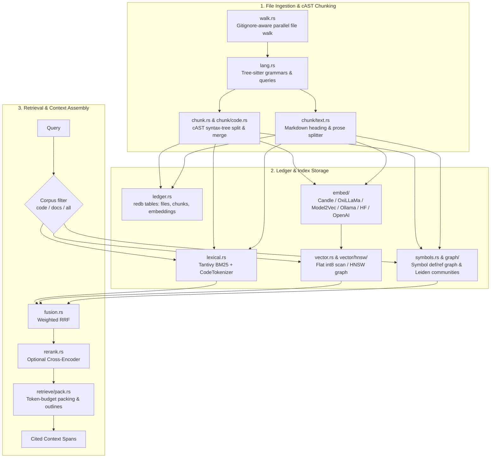

# loom-rag

[](Cargo.toml)
[](../../Cargo.toml)

`loom-rag` is a retrieval engine for source code repositories and technical documentation. It provides incremental AST-aware chunking, code-tokenized BM25 search, dense vector embeddings with an int8 flat index scan (and an optional HNSW index), code graph community detection, symbol ranking, and token-budgeted context packing.

It does not depend on Dendrite, so it can be used as an embedded library in any Rust application or toolchain.

---

## Key Capabilities

- **cAST Syntax-Tree Chunking**: Tree-sitter split-then-merge chunker that respects semantic language structures (functions, methods, classes, impl blocks, markdown headings) rather than arbitrary line windows. Each chunk carries its qualified scope chain, the symbols it defines and the names it references, and is indexed with a header of its path and scope.
- **Code-Aware BM25**: Backed by [Tantivy](https://github.com/quickwit-oss/tantivy), using a specialized `CodeTokenizer` that indexes whole identifiers alongside sub-tokens split across `camelCase`, `snake_case`, and digit boundaries. The BM25 parameters `k1`, `b` and `q` are configurable (`Config::bm25`, `Bm25Params`); the defaults are 1.2, 0.75 and 1, and `q` below 1 scored worse in the evaluation (see [`eval/RESULTS.md`](../../eval/RESULTS.md)).
- **Pluggable Vector Embeddings**: Unified `Embedder` trait supporting:
  - **In-process**: [Candle](https://github.com/huggingface/candle) (BERT, JinaBERT, NomicBERT with Metal/CUDA/Accelerate support), OxiLLaMa (GGUF Qwen3-Embedding, CPU only for embeddings), [Model2Vec](https://github.com/MinishLab/model2vec) (static embeddings).
  - **Local/Remote Gateways**: Ollama, Hugging Face Inference or Text Embeddings Inference (TEI) (`hf`), OpenAI-compatible gateways (`openai`, e.g. LiteLLM).
  - **Auto-Selection** (`backend = auto`): the first available of candle on a GPU (Metal or CUDA build), a TEI server (`HF_TEI_ENDPOINT`), Ollama, a LiteLLM gateway (`LITELLM_PROXY_URL`), candle on the CPU, model2vec; with none of them, lexical and symbol retrieval only (`none`).
  - **Settings**: `EmbedConfig` also takes `dimensions` (target vector size, Matryoshka models) and `budget_tokens` (a token budget that caps one indexing run; the next run continues where it stopped).
- **Int8 Quantized Flat Scan & HNSW**:
  - Each vector is stored as int8 components plus an `f32` scale. The scan computes integer dot products over the rows in parallel (rayon), then rescores the shortlist (at least 40 candidates) with the exact `f32` vectors from the ledger.
  - Optional Hierarchical Navigable Small World (`hnsw` feature) index, chosen with `Config::vector_index`. The default `auto` always picks the flat scan: in the benchmark (768-d vectors, [`eval/RESULTS.md`](../../eval/RESULTS.md)) HNSW lost to the flat scan on build time, latency and recall.
- **Code Graph & Leiden Community Detection**:
  - Builds typed call, import, and type reference graphs across symbols and files.
  - Runs the Leiden modularity optimization algorithm to cluster files into communities.
  - Ranks symbol-name matches as a third ranking next to BM25 and dense search.
- **Weighted Reciprocal Rank Fusion (RRF)**:
  - Fuses lexical BM25, dense vector similarity, and symbol matches into a single score without requiring score scale normalization. The weights are configurable (`Config::fusion`, a `FusionConfig` that overrides `FusionWeights`: `lexical`, `dense`, `symbol`, `community`).
- **Optional Cross-Encoder Rerank**:
  - Reranks the fused hits through a Cohere-style `/v1/rerank` gateway or an in-process candle cross-encoder (`candle` feature).
  - `[rerank] abstain` (`RerankConfig::abstain`) returns no hits when the best hit is unlikely to be relevant. It is off by default.
- **Token-Budgeted Context Packer**:
  - Packs top-ranked spans into prompt-ready context packs that stay within an estimated token budget.
  - Outlines a span (doc comment or heading plus declaration) when its full text no longer fits; `Detail::Map` returns outlines only.
  - Folds identical text found in several files into one span, and expands the best code hits one hop along the symbol graph.
- **Incremental Indexing & Change Detection**:
  - Uses BLAKE3 file hashing and Merkle tree diffing (`embedag`) to re-index only changed files.
  - Caches embeddings in the ledger, keyed by model and chunk content hash: chunk embeddings are not recomputed if the content did not change.
- **Storage Backends**:
  - The local ledger is [redb](https://github.com/cberner/redb) by default. SQLite is opt-in: build with the `sqlite` feature and set `[storage] ledger = "sqlite"` (`StorageConfig::ledger`). The SQLite, sqlite-vec and Turso decisions are in [`docs/specs/store.md`](../../docs/specs/store.md).
  - PostgreSQL 16 with pgvector (`postgres` feature) serves the shared tier (`remote` and `edge` storage modes).
- **Git History Search**:
  - Full-text Tantivy index over commit messages and per-file diffs.

---

## Architecture & Module Layout



### Module Guide

| Module | Description |
|---|---|
| [`walk`](src/walk.rs) | Parallel directory traversal respecting gitignore rules and hidden files, with a fixed skip list (`.git`, `target`, `node_modules`, `vendor`, ...), a binary-file check, and a file size cap (1 MiB by default). |
| [`lang`](src/lang.rs) | Language detection by file extension and Tree-sitter grammars for Go, Rust, Python, TypeScript, TSX, JavaScript, Java, C, and C++. Markdown and plain text are split without a grammar. |
| [`chunk`](src/chunk.rs) | cAST AST-aware splitting (`chunk/code.rs`), Markdown hierarchical heading splitting (`chunk/text.rs`), and contextual header generation. |
| [`corpus`](src/corpus.rs) | Corpus segmentation (`Code` vs `Docs`) and the corpus filter of a query (`all`, `code`, `docs`). |
| [`config`](src/config.rs) | `GraphLlmSettings` and `VectorIndexChoice`. The other configuration types live next to what they configure: `Config` in `engine`, `EmbedConfig` in `embed`, `Bm25Params` in `bm25`, `FusionWeights` and `FusionConfig` in `retrieve`, `StorageConfig` in `store`, `RerankConfig` in `rerank`. |
| [`ledger`](src/ledger.rs) | Embedded ACID storage via `redb`: files, chunk metadata, Merkle roots, and chunk embedding caches. |
| [`bm25`](src/bm25.rs) | Okapi BM25 parameters (`k1`, `b`, `q`) and formula shared by Tantivy, PostgreSQL, and `rank`. |
| [`lexical`](src/lexical.rs) | Tantivy full-text indexing, BM25 scoring, and `CodeTokenizer` splitting on case transitions and numbers. |
| [`embed`](src/embed/mod.rs) | `Embedder` trait with backends: `candle` (Metal/CUDA), `oxillama` (GGUF), `model2vec`, `ollama`, `hf`, `openai`, and `none`. |
| [`vector`](src/vector.rs) | Vector indexes: `FlatIndex` with int8 quantization and optional `HnswIndex` (`vector/hnsw/`, `hnsw` feature). |
| [`symbols`](src/symbols.rs) | Extracted definitions and references, symbol-name ranking, and chunk neighbors. |
| [`graph`](src/graph/mod.rs) | Semantic code graph: call, import, and type edges; Leiden community clustering; path and explain queries. |
| [`fusion`](src/fusion.rs) | Weighted Reciprocal Rank Fusion (`rrf`). |
| [`rerank`](src/rerank.rs) | Cross-encoder `Reranker` trait with a gateway HTTP backend and an in-process candle backend, plus the optional abstain threshold. |
| [`retrieve`](src/retrieve/mod.rs) | Code search (`retrieve/code.rs`), docs search (`retrieve/docs.rs`), mixed code-and-docs context packs (`retrieve/mixed.rs`), a corpus probe used by `loom-eval` (`retrieve/route.rs`), and context packing (`retrieve/pack.rs`). |
| [`engine`](src/engine.rs) | `Engine`: cold/incremental indexing, vector sync, status, and search operations. |
| [`store`](src/store/mod.rs) | Storage backends: local redb (default), SQLite ledger (`store/sqlite.rs`, `sqlite` feature), PostgreSQL (`store/pg.rs`) and edge mirroring (`store/edge.rs`), both under the `postgres` feature. |
| [`history`](src/history.rs) | Git commit and diff indexing, one document per commit and file, for history queries. |
| [`lookup`](src/lookup.rs) | Exact symbol definition and reference lookups, regex grep across indexable files. |
| [`rank`](src/rank.rs) | Ranking of caller-supplied documents with BM25, the project's embedder (embeddings cached in the ledger), and weighted RRF. |
| [`llm`](src/llm.rs) | Client for an OpenAI-compatible chat completions endpoint, used for community summaries and concept extraction. |

---

## Cargo Features

No feature is enabled by default.

| Feature | Description |
|---|---|
| `hnsw` | Enables the Hierarchical Navigable Small World index (`HnswIndex`). |
| `candle` | In-process safetensors encoders (BERT, JinaBERT, NomicBERT) via Hugging Face Candle. |
| `candle-metal` | Enables Apple Silicon GPU acceleration via Metal for Candle embedders. |
| `candle-cuda` | Enables NVIDIA GPU CUDA acceleration for Candle embedders (needs the CUDA toolkit to build). |
| `candle-accelerate` | Enables Apple Accelerate framework BLAS on macOS CPU. |
| `oxillama` | Enables in-process GGUF embedding models (Qwen3-Embedding and other decoder models) via the OxiLLaMa runtime; needs Rust 1.89. |
| `model2vec` | Enables in-process static subword embeddings using `model2vec-rs`. |
| `sqlite` | Enables SQLite as an alternative local ledger (`[storage] ledger = "sqlite"`). The default ledger is redb. |
| `postgres` | Enables the PostgreSQL 16 + `pgvector` backend for the shared tier (`[storage] mode = "remote"` or `"edge"`). |
| `testutil` | Test fixtures and project scaffolding helpers (`loom_rag::testutil`). |
| `dhat` | Enables DHAT heap profiling for the peak-heap test (`tests/peak_heap.rs`). |

---

## Library Usage Example

Add `loom-rag` to your `Cargo.toml`:

```toml
[dependencies]
loom-rag = { version = "0.1.0", path = "path/to/crates/loom-rag" }
```

### Basic Indexing and Hybrid Search

```rust
use std::path::Path;
use loom_rag::engine::{Engine, Config};
use loom_rag::retrieve::{SearchOpts, Mode};

fn main() -> anyhow::Result<()> {
    let repo_path = Path::new(".");
    let config = Config::default();

    // 1. Open or initialize the engine
    let mut engine = Engine::open(repo_path, config)?;

    // 2. Perform incremental indexing
    let report = engine.index(false)?;
    println!(
        "Indexed {} files ({} changed) into {} chunks in {} ms",
        report.files_scanned, report.files_changed, report.chunks_added, report.duration_ms
    );

    // 3. Search using hybrid BM25 + Vector retrieval
    let hits = engine.search(
        "reciprocal rank fusion",
        &SearchOpts {
            top_k: 5,
            mode: Mode::Hybrid,
            ..SearchOpts::default()
        },
    )?;

    for hit in hits {
        println!(
            "{:.4}  {}:{}-{}  {}",
            hit.score,
            hit.path,
            hit.start_line,
            hit.end_line,
            hit.scope.join(" > ")
        );
    }

    // 4. Build a prompt context pack budgeted to 2,000 estimated tokens
    let pack = engine.context("how does code chunking work?", 2000)?;

    println!("Context Pack (~{} tokens in {} spans):", pack.tokens, pack.spans.len());
    for span in &pack.spans {
        println!("--- {}:{}-{} ---\n{}", span.path, span.start_line, span.end_line, span.content);
    }

    Ok(())
}
```

---

## Examples Guide

The crate includes four standalone examples in the `examples/` directory:

### 1. `chunk_stats`
Walks the project, chunks all recognized files, and prints the file and chunk counts, walk and total time, how many chunks have a scope or symbols, and the median, p95 and largest chunk size in bytes:

```bash
cargo run --release --example chunk_stats -p loom-rag -- <root>
```

### 2. `graph_stats`
Indexes a project (lexical only), builds the typed symbol graph (calls, imports, types) and runs Leiden community detection. It prints the edge counts, the 15 symbols with the most users, and the 20 largest communities:

```bash
cargo run --release --example graph_stats -p loom-rag -- <root> [index-dir] [redb|sqlite]
```

The `sqlite` ledger needs `--features sqlite`.

### 3. `probe`
Indexes a project into `$TMPDIR/loom-rag-probe` (embeddings use the default `auto` configuration), indexes it again to show that unchanged files are skipped, prints the engine status, then runs each query you pass in lexical and dense mode:

```bash
cargo run --release --example probe -p loom-rag -- <root> "<query>"
```

### 4. `vector_bench`
Compares the build time, single-reader latency, 8-reader concurrent latency, and recall@10 of the `FlatIndex` int8 scan against `HnswIndex` graph search on clustered synthetic vectors, across corpus sizes. Arguments are the vector dimension followed by the sizes; `BENCH_FLAT_ONLY=1` skips HNSW. Measured results are in [`eval/RESULTS.md`](../../eval/RESULTS.md).

```bash
# Requires --features hnsw
cargo run --release --features hnsw --example vector_bench -p loom-rag -- 64 1000 5000
```

---

## Testing

Run unit and integration tests across the crate:

```bash
cargo test -p loom-rag
```

Run benchmarks (using Criterion):

```bash
cargo bench -p loom-rag --features testutil
```
