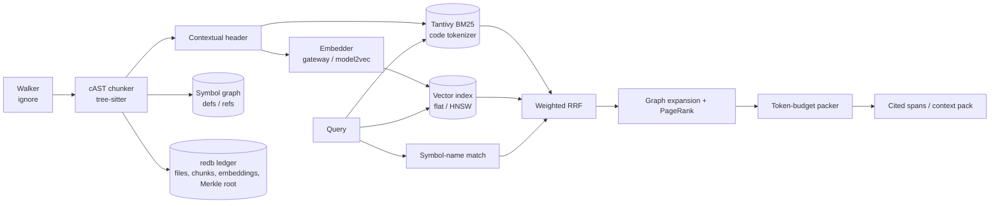

# dendrite-rag-rs Architecture

`dendrite-rag-rs` is a retrieval engine for source-code repositories. It indexes a project once and keeps the index current incrementally. It answers natural-language or identifier queries with ranked, cited code spans, or with a context pack packed to a token budget and ready to put in an LLM prompt. It does not generate answers; callers own the LLM step.

The crate is `dendrite-rag` (library `dendrite_rag`, binary `dendrite-rag`).

## 1. Pipeline

| Stage | Responsibility | Spec |
|---|---|---|
| Walk | gitignore-aware parallel walk; binary and oversized files skipped; language from the extension | [specs/chunking.md](specs/chunking.md) |
| Chunk | cAST split-then-merge over the tree-sitter syntax tree; Markdown split by headings; text fallback | [specs/chunking.md](specs/chunking.md) |
| Index | Code-aware BM25 (Tantivy), dense vectors (flat scan or HNSW), symbol graph | [specs/retrieval.md](specs/retrieval.md) |
| Incremental update | BLAKE3 file hashes and a Merkle tree detect changed files; only their chunks are re-indexed, and only new chunk hashes are embedded | [specs/store.md](specs/store.md) |
| Search | Weighted Reciprocal Rank Fusion over lexical, dense and symbol-name rankings; optional cross-encoder rerank | [specs/retrieval.md](specs/retrieval.md) |
| Context | Symbol-graph expansion, overlap removal, packing to a token budget with `path:line` citations | [specs/retrieval.md](specs/retrieval.md) |
| Serve | JSON-RPC 2.0 over stdio | [specs/protocol.md](specs/protocol.md) |

## 2. Design principles

- **Local and incremental.** The index lives in the project (`.dendrite/rag/` by default). A re-index touches only changed files, and an embedding is never computed twice for the same chunk content.
- **Structure-aware.** Chunks follow syntax boundaries (functions, types, impl blocks) instead of fixed line windows. Each chunk carries its scope chain and signature, so lexical and dense retrieval both see *where* the code lives.
- **Hybrid by default.** Identifier-heavy queries are won by BM25 with a code tokenizer. Conceptual queries are won by embeddings. Rank fusion combines them without tuning score scales.
- **Small footprint.** Pure-Rust storage (redb, Tantivy, hnsw_rs). The only native code is the tree-sitter grammars, compiled from C sources by `cc` with no system libraries. Targets: under 200 MB RSS at 50k chunks, p95 query latency under 30 ms with 8 concurrent readers.
- **Pluggable models.** Embedding and reranking sit behind traits. The default embedder calls an OpenAI-compatible `/v1/embeddings` endpoint (the Dendrite LiteLLM gateway). An in-process model2vec embedder works fully offline.

## 3. Modules

| Module | Contents |
|---|---|
| `walk` | File discovery, language detection, size and binary filters |
| `lang` | Languages, tree-sitter grammars and their tag queries |
| `chunk` | cAST splitter, Markdown and text splitters, definitions/references/scope, contextual headers |
| `ledger` | redb tables: files, chunks, embedding cache, metadata |
| `lexical` | Tantivy schema, code tokenizer, BM25 search |
| `embed` | `Embedder` trait, gateway and model2vec backends |
| `vector` | `VectorIndex` trait, exact int8 flat index |
| `symbols` | Symbol tables, chunk neighbours, file reference graph, personalized PageRank |
| `fusion` | Weighted RRF |
| `rerank` | `Reranker` trait, gateway cross-encoder |
| `engine` | `Engine::open / index / status / purge`, incremental indexing and the embedding phase |
| `retrieve` | `search` (hybrid, lexical, dense; paths, threshold, pagination) and `context` packing |
| `lookup` | Symbol definitions and references, regex `grep`, history indexing and search |
| `history` | Git history index: (commit, file) documents from `git log -p`, incremental by last indexed commit |
| `rpc`, `server` | JSON-RPC 2.0 framing and the method table |

## 4. Other owned capabilities (planned)

- Content-addressed segmented store with chunk checkpoints and purge: [specs/store.md](specs/store.md)
- Memory synchronization modes (`local-only`, `edge`, `push`): [specs/memory-sync.md](specs/memory-sync.md)
- Structured topic memory with a zero-extrapolation fidelity guard: [specs/topic-memory.md](specs/topic-memory.md)

## 5. Relation to sibling repositories

- **dendrite-control** (Dendrite Go control plane) starts `dendrite-rag` through its sidecar client for `dendrite ask` and `dendrite store`. It keeps an in-process Go implementation as a fallback when the binary is missing.
- **dendrite-mcp-hub** exposes retrieval as the `dendrite_rag_retrieve` and `dendrite_rag_ask` MCP tools.
- **dendrite-core-rs** owns signature folding, complexity metrics and token counting. dendrite-rag-rs currently parses code with tree-sitter on its own for retrieval chunking; it can switch to a shared parser once core-rs exposes one.
- **embedag** supplies the BLAKE3 Merkle tree (`embedag-core`) used for change detection.

See [RESPONSIBILITIES.md](RESPONSIBILITIES.md) for the ownership boundary and the ticket map.
