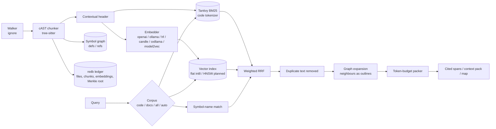

# dendrite-rag-rs Architecture

`dendrite-rag-rs` is a retrieval engine for code and documentation. It indexes a project once and keeps the index current incrementally. It answers natural-language or identifier queries with ranked, cited spans, or with a context pack packed to a token budget and ready to put in an LLM prompt.

The workspace has three crates:

| Crate | Kind | Contents |
|---|---|---|
| `loom-rag` (`crates/loom-rag`) | library `loom_rag` | The engine, free of any Dendrite reference: walking, chunking, corpora, the indexes and stores, embedders, fusion, the code graph, retrieval and context packing. Its index lives in `<root>/.loom` unless the caller sets another directory. |
| `dendrite-rag` (`crates/dendrite-rag`) | binary `dendrite-rag`, library `dendrite_rag` | Dendrite's adapter: the JSON-RPC protocol and CLI, the `.dendrite/rag.toml` settings with their `DENDRITE_RAG_*` overrides (index in `.dendrite/rag`), and `ask` with Dendrite's prompts and model tiers. |
| `loom-eval` (`crates/loom-eval`) | binary | The evaluation: quality, tokens read and latency of the engine's methods against baselines (grep-driven agent, BM25 over files, fixed line windows) on golden sets and CoIR tasks, the corpus probe, and the repeated-question timing run (`eval/RESULTS.md`). |

No Rust file is over 500 lines (checked in CI); tests live in sibling `tests.rs` files.

## 1. Pipeline

| Stage | Responsibility | Spec |
|---|---|---|
| Walk | gitignore-aware parallel walk; binary and oversized files skipped; language from the extension | [specs/chunking.md](specs/chunking.md) |
| Chunk | cAST split-then-merge over the tree-sitter syntax tree; Markdown split by headings; text fallback | [specs/chunking.md](specs/chunking.md) |
| Index | Code-aware BM25 (Tantivy), dense vectors (flat int8 today, HNSW planned: DRAG-37), symbol graph | [specs/retrieval.md](specs/retrieval.md) |
| Incremental update | BLAKE3 file hashes and a Merkle tree detect changed files; only their chunks are re-indexed, and only new chunk hashes are embedded | [specs/store.md](specs/store.md) |
| Search | Weighted Reciprocal Rank Fusion over lexical, dense and symbol-name rankings; optional cross-encoder rerank | [specs/retrieval.md](specs/retrieval.md) |
| Graph | Typed call, import and type edges between files and symbols | [specs/graph.md](specs/graph.md) |
| Corpora | Code and documentation pipelines over shared stores; `auto` narrows `all` to one corpus when the other is absent from the best candidates | [specs/retrieval.md](specs/retrieval.md) |
| Context | Symbol-graph expansion, overlap removal, packing to a token budget with `path:line` citations; `detail` from full text to an outline map | [specs/retrieval.md](specs/retrieval.md) |
| Serve | JSON-RPC 2.0 over stdio | [specs/protocol.md](specs/protocol.md) |

## 2. Design principles

- **Local and incremental.** The index lives in the project (`.loom/`, or `.dendrite/rag/` through the Dendrite adapter). A re-index touches only changed files, and an embedding is never computed twice for the same chunk content.
- **Structure-aware.** Chunks follow syntax boundaries (functions, types, impl blocks) instead of fixed line windows. Each chunk carries its scope chain and signature, so lexical and dense retrieval both see *where* the code lives.
- **Hybrid by default.** Identifier-heavy queries are won by BM25 with a code tokenizer. Conceptual queries are won by embeddings. Rank fusion combines them without tuning score scales.
- **Small footprint.** Pure-Rust storage (redb, Tantivy). The only native code is the tree-sitter grammars, compiled from C sources by `cc` with no system libraries. Vectors are flat int8 today, HNSW planned (DRAG-37). Targets: under 200 MB RSS at 50k chunks, p95 query latency under 30 ms with 8 concurrent readers.
- **The project chooses its model.** Embedding and reranking sit behind traits. Every backend is a first-class choice, selected per project (in Dendrite, `.dendrite/rag.toml` or the environment) ([specs/embedders.md](specs/embedders.md)): OpenAI-compatible servers (the LiteLLM gateway by default), Ollama, Hugging Face Inference or TEI, and in-process engines that work offline.

## 3. Modules

`loom-rag`:

| Module | Contents |
|---|---|
| `walk` | File discovery, language detection, size and binary filters |
| `lang` | Languages, tree-sitter grammars and their tag queries |
| `chunk` | cAST splitter (`chunk/code`), Markdown and text splitters (`chunk/text`), definitions/references/scope, contextual headers |
| `corpus` | Code or documentation, per chunk from its path and language; the `CorpusFilter` of a query |
| `config` | Configuration types shared with the programs that configure the engine |
| `ledger` | redb tables: files, chunks, embedding cache, metadata |
| `lexical` | Tantivy schema, code tokenizer, BM25 search |
| `embed` | `Embedder` trait and backends: `auto` (GPU first: candle on Metal/CUDA, TEI, Ollama), `openai`, `ollama`, `hf`, `candle`, `oxillama` (CPU only), `model2vec` |
| `vector` | `VectorIndex` trait, exact int8 flat index, HNSW (`vector/hnsw/{graph,persist}`) |
| `symbols` | Symbol tables, chunk neighbours, file reference graph |
| `fusion` | Weighted RRF |
| `rerank` | `Reranker` trait, gateway and candle cross-encoders |
| `engine` | `Engine::open / status / purge`; `engine/index` (incremental runs), `engine/vectors` (embedding and dense ranking), `engine/enrich` (communities, LLM concepts), `engine/tier` (shared tier) |
| `retrieve` | `search` and `context`: `retrieve/code` and `retrieve/docs` pipelines, `retrieve/route` (`auto`), `retrieve/pack` (dedup, outlines, packing) |
| `store` | Local, PostgreSQL (`store/pg/{ledger,lexical,vectors}`) and edge (`store/edge`) backends |
| `graph` | Typed code graph, communities, summaries, queries (`graph/query/{path,explain}`) |
| `lookup`, `history`, `rank`, `llm` | Symbol lookups and grep; git history index; ranking supplied documents; OpenAI-compatible chat client |

`dendrite-rag`: `rpc` and `server` (JSON-RPC 2.0 framing and the method table), `settings` (`.dendrite/rag.toml` and `DENDRITE_RAG_*` into a `loom_rag::engine::Config`), `ask` (prompts, local/hybrid/paid tiers), `main` (CLI).

## 4. Other owned capabilities (planned)

- Content-addressed segmented store with chunk checkpoints and purge: [specs/store.md](specs/store.md)
- Memory synchronization modes (`local-only`, `edge`, `push`): [specs/memory-sync.md](specs/memory-sync.md)
- Structured topic memory with a zero-extrapolation fidelity guard: [specs/topic-memory.md](specs/topic-memory.md)

## 5. Relation to sibling repositories

- **dendrite-control** (Dendrite Go control plane) starts `dendrite-rag` through its sidecar client for `dendrite ask` and `dendrite store`.
- **dendrite-mcp-hub** exposes retrieval as the `dendrite_rag_retrieve` and `dendrite_rag_ask` MCP tools.
- **dendrite-core-rs** owns signature folding, complexity metrics and token counting. dendrite-rag-rs currently parses code with tree-sitter on its own for retrieval chunking; it can switch to a shared parser once core-rs exposes one.
- **embedag** supplies the BLAKE3 Merkle tree (`embedag-core`) loom-rag uses for change detection.

See [RESPONSIBILITIES.md](RESPONSIBILITIES.md) for the ownership boundary and the ticket map.
