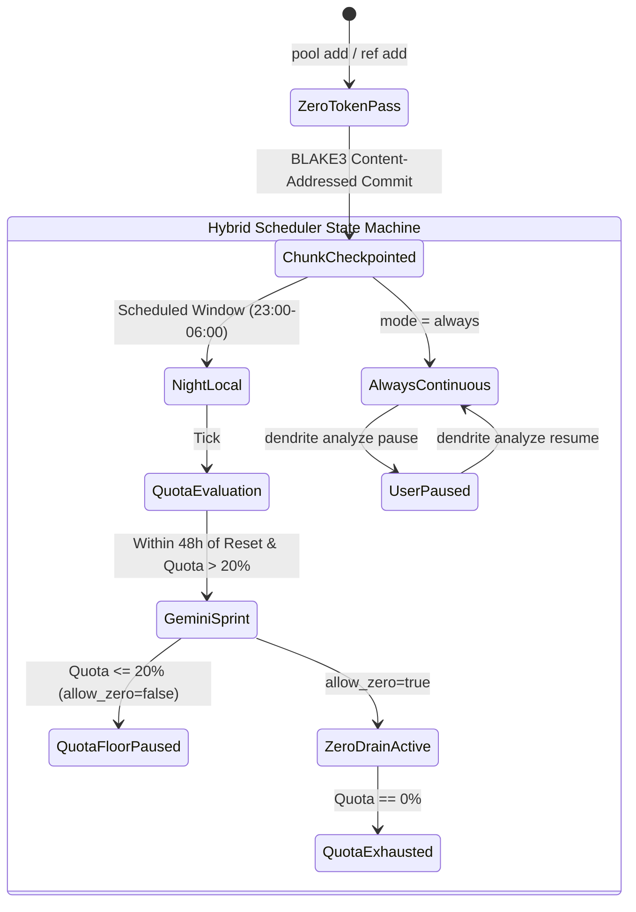

<!-- Imported from Dendrite docs/features/FEAT-031-persistent-store-hybrid-token-scheduler.md @ 69ea048 on 2026-10-18. Source of truth for this repo's scope; keep in sync with the Dendrite copy until the extraction umbrella lands. -->

---
id: FEAT-031
title: "Persistent Segmented Analysis Store & Token-Aware Hybrid Scheduler"
status: approved
plane_epic: PROJ-E-15
dependencies: [FEAT-002, FEAT-010, FEAT-020, FEAT-028]
repository: dendrite
tags: [dendrite-store, hybrid-scheduler, blake3, chunking, gemini-sprint, quota-governance]
---

# FEAT-031: Persistent Segmented Analysis Store & Token-Aware Hybrid Scheduler

## 1. Executive Summary & Problem Statement

### The Problem
Large-scale repository and binary reverse engineering requires extensive static and semantic analysis. Repeatedly analyzing codebases drains costly cloud LLM tokens and wastes developer time. Furthermore, developers often have weekly cloud token quotas (such as Google Gemini Pro) that go unused during the week and expire, while incurring cloud charges for tasks that could have run locally overnight at zero cost.

### User Story & Architectural Pillars
As an AI-assisted systems engineer, I need `dendrite store` to persist all analyzed artifacts in content-addressed, token-efficient chunks permanently until I explicitly delete them, and `dendrite analyze` to govern analysis runs through a **Token-Aware Hybrid Scheduler**:
1. Zero-token Go AST / CFG extraction immediately on project addition.
2. Night-window (23:00–06:00) local execution via Ollama/Metal ($0.00 cost).
3. 48-hour pre-reset Cloud Gemini Sprint down to a 20% safety reserve (or 0% drain override).
4. Continuous `always` mode with instant pause/resume controls.

---

## 2. Technical Architecture & Idiomatic Design Patterns

### 2.1 Content-Addressed Persistent Segmented Store (`dendrite store`)
- **Storage Layer**: SQLite metadata index (`~/.dendrite/store/meta.db`) + Zstandard-compressed serialized graph blobs (`~/.dendrite/store/blobs/`).
- **BLAKE3 Hashes**: Content hashes for every file, function, and binary CFG block.
- **Chunk State Model**:
  - `STORED`: 100% complete analysis.
  - `ANALYZING_PARTIAL`: Modular chunks partially committed (available for intermediate queries).
  - `QUEUED_NIGHT_LOCAL`: Deferred to zero-cost local execution window.
  - `PAUSED_QUOTA_FLOOR`: Paused at safety reserve threshold.

### 2.2 Hybrid Scheduler Governance Directives
- **Zero-Token Pass**: Fast AST extraction using Go tree-sitter.
- **Sprint Trigger**: Automatically fires 48 hours before weekly reset to prevent quota waste.
- **Reserve Floor Guard**: Stops cloud calls at 20% remaining capacity unless `--allow-zero on` override is configured.

---

## 3. Acceptance Criteria & Definition of Done

- [ ] **AC-1 (BLAKE3 Persistent Segmented Store)**: Files, functions, and CFG blocks indexed via BLAKE3 in SQLite with Zstd compression; intermediate queries run on `ANALYZING_PARTIAL` state.
- [ ] **AC-2 (Store Inspection & Manual Purge)**: CLI and UI provide real-time status inspection and explicit deletion controls.
- [ ] **AC-3 (Hybrid Token-Aware Scheduler)**: Executes 0-token AST pass immediately, local Ollama night window (23:00-06:00), and activates 48h pre-reset Gemini Sprint.
- [ ] **AC-4 (Quota Floor & Pause Switch)**: Enforces 20% safety floor with 0% drain override toggle, continuous mode, and pause/resume checkpoints.
- [ ] **AC-5 (Mandatory Persistent Layer Testing)**: Store transactions and SQLite recovery validated via `testcontainers-go`; statement coverage >= 85%.
