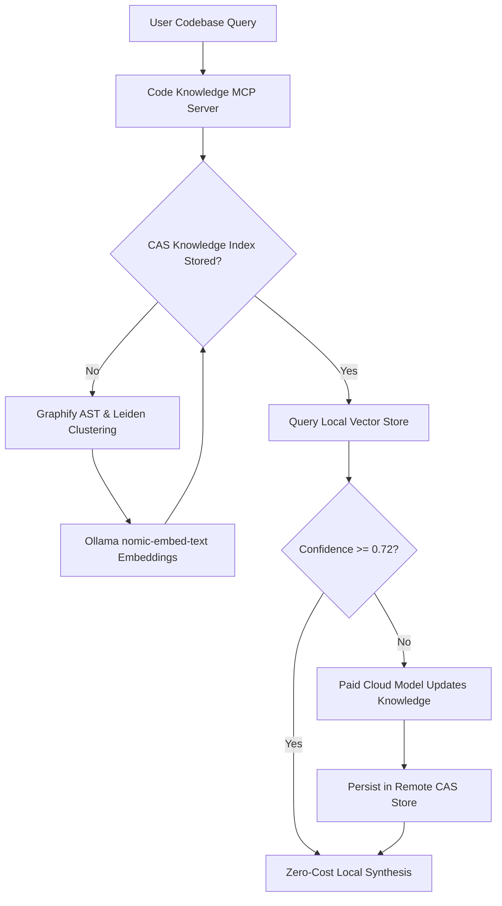

<!-- Imported from Dendrite docs/features/FEAT-045-code-knowledge-mcp-graphify.md @ 69ea048 on 2026-10-18. Source of truth for this repo's scope; keep in sync with the Dendrite copy until the extraction umbrella lands. -->

# FEAT-045: Code Knowledge MCP, AST Graphify & Local-First RAG Deduplication

## 1. Executive Summary & Context
Engineering queries regarding proprietary codebases frequently exhaust expensive cloud tokens. FEAT-045 designs:
1. **Code Knowledge MCP Server**: A native Model Context Protocol JSON-RPC service providing semantic symbol navigation, call-graph tracing, and structural summaries.
2. **Graphify AST & Community Graphs**: Employs Tree-sitter parsers and Leiden community detection to identify structural god nodes, file clusters, and dependency boundaries.
3. **Local-First RAG Cascade**: Queries local vector embeddings (`nomic-embed-text:latest` via Ollama Metal) first; if semantic confidence drops below $0.72$, it cascades to cloud models to index missing context before repeating the query.
4. **Multi-Project Shared Library Deduplication**: Implements a Content-Addressable Storage (CAS) layer that hashes identical third-party library versions across projects, saving disk space and eliminating redundant indexing token consumption.

---

## 2. Architecture & RAG Fallback Cascade



### 2.1 Graphify Ingestion & Leiden Community Index
- Parses language ASTs (Go, Rust, TypeScript, Python) into directed call and dependency graphs.
- Groups cohesive sub-graphs into communities using the Leiden modularity algorithm.
- Identifies **God Nodes** (symbols with in-degree > 20) and provides condensed topological summaries for coding agents.

### 2.2 Content-Addressable Shared Library Deduplication
- Multiple workspace projects often use identical dependency versions (e.g., `serde v1.0.210`, `tokio v1.40`, `gin v1.10`).
- The engine hashes package source tarballs (`SHA-256`) and stores the parsed AST graph in a global store (`~/.dendrite/cache/cas/`).
- Prevents re-analyzing identical libraries, reducing indexing time and disk usage by $> 65\%$.

---

## 3. Plane Tickets

| Ticket ID | Title | Priority | Estimate | Milestone | Start Date | Target Date | Blocked By |
|:---|:---|:---:|:---:|:---|:---:|:---:|:---|
| **DEND-201** | [Code Knowledge MCP]: Local AST query MCP server | High | 5 SP | Milestone 21 | 2026-10-27 | 2026-10-28 | DEN-040 |
| **DEND-202** | [Graphify Community Graph]: Leiden clustering & god-node dependency index | High | 8 SP | Milestone 21 | 2026-10-29 | 2026-10-30 | DEND-201 |
| **DEND-203** | [Local-First RAG & Shared Library Deduplication]: Zero-cost nomic embeddings & CAS library store | Urgent | 8 SP | Milestone 21 | 2026-10-31 | 2026-11-01 | DEND-202 |

---

## 4. Grouped GitHub Validation Issues

### GitHub Issue #3: Validate Local-First Code Knowledge MCP, Graphify AST Communities & Zero-Cost RAG Escalation
- **Covers Plane Tickets**: `DEND-201`, `DEND-202`, `DEND-203`
- **Acceptance Criteria**:
  1. MCP endpoint responds to codebase queries without querying cloud APIs when local confidence is sufficient.
  2. Graphify index surfaces community clusters and god nodes in $< 2\text{s}$.
  3. Shared library versions across workspaces share a single CAS cache entry on disk.
  4. Deliberate low-confidence prompt triggers zero-loss cloud index update followed by local synthesis.
- **Replication & Evaluation Instructions**:
  ```bash
  # 1. Ingest workspace using Graphify community extractor
  dendrite mcp call graphify.ingest '{"path": ".", "deduplicate_libraries": true}'

  # 2. Query code knowledge with zero cloud tokens assertion
  dendrite mcp call knowledge.query \
    '{"repo": "dendrite", "question": "Trace CLI entrypoint to Plane sync"}'

  # 3. Verify CAS deduplication across projects
  dendrite store status --cas
  ```
