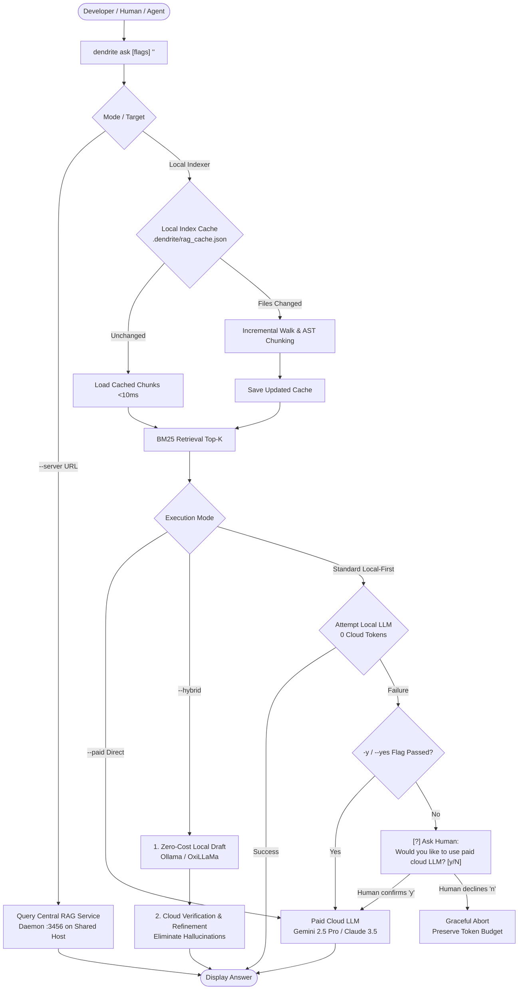

<!-- Imported from Dendrite docs/guides/asking-questions-to-dendrite.md @ 69ea048 on 2026-10-18. Source of truth for this repo's scope; keep in sync with the Dendrite copy until the extraction umbrella lands. -->

---
id: asking-questions-to-dendrite
title: "Tutorial: Asking Project Questions with Local RAG & Paid LLM Escalation"
sidebar_label: "Project Q&A with Local RAG"
sidebar_position: 12
tags: [rag, qa, query, ask, local-llm, hybrid, central-rag, ollama, oxillama, litellm, gemini]
---

# Tutorial: Asking Project Questions with Local RAG & Paid LLM Escalation

This tutorial demonstrates how to use the `dendrite ask` command to ask questions about your codebase, documentation, and infrastructure.

Dendrite implements a **Local-First, Zero-Cost RAG (Retrieval-Augmented Generation)** architecture:
1. It incrementally indexes your project files (Markdown guides, specs, source code) into an in-memory Okapi BM25 semantic index with persistent disk caching (`.dendrite/rag_cache.json`).
2. It first attempts to synthesize answers using your **zero-cost local LLM** (e.g. Ollama or OxiLLaMa).
3. If the local LLM is offline or fails, it **prompts the human** interactively before spending any cloud budget.
4. You can pass the **`-y` / `--yes`** flag to instruct Dendrite to automatically call the paid cloud model directly upon local failure.
5. You can use **Hybrid Mode (`--hybrid`)** for local-first drafting with paid cloud refinement and verification.
6. In team and multi-project environments, queries can be delegated to a **Central RAG Service (`--server`)**.

---

## 1. Architecture & Decision Flow



---

## 2. Walkthrough Example: "I want to know how to check available LLMs"

In this example, we ask Dendrite how to check available LLMs across the system.

### Step 1: Execute with Local RAG First

Run the query in your terminal:

```bash
dendrite ask "I want to know how to check available LLMs"
```

#### What Happens Under the Hood:
1. **Indexing**: Dendrite checks `.dendrite/rag_cache.json`. If unchanged, it loads the index in $< 10\text{ms}$. If new or modified files exist, it parses them incrementally.
2. **Context Retrieval**: Okapi BM25 extracts top relevant chunks from `cmd/dendrite/inference.go`, `docs/features/FEAT-020-pluggable-inference-engines.md`, and related guides.
3. **Local Synthesis**: Dendrite calls your local model (`hermes3:8b`, `qwen2.5-coder:14b`, or `llama3.2`).
4. **Result Output**:

```text
[+] Querying Dendrite RAG index for: "I want to know how to check available LLMs"

================================================================================
[✓] Answer (Zero-Cost Local LLM | Model: hermes3:8b | Time: 1.42s | Index: cached):
================================================================================
You can check available LLMs in Dendrite using the following commands:

1. List all registered multi-provider inference engines and models:
   $ dendrite inference list
   (or alias: dendrite dev inference list)

2. Inspect configured zero-cost and self-hosted models:
   $ dendrite dev inference zero-cost list

3. Probe active Ollama health, latency, and loaded models:
   $ dendrite dev ollama probe

4. Probe reachability for all registered engines:
   $ dendrite dev inference probe
================================================================================

[+] Retrieved Project Documentation & Code Context:
    1. cmd/dendrite/inference.go (lines 14-45) > handleInferenceCommand
    2. docs/features/FEAT-020-pluggable-inference-engines.md (lines 60-95)
    3. docs/guides/oxillama-jetbrains-integration.md (lines 35-70)
```

---

## 3. Hybrid Mode: Local First, Paid Refinement (`--hybrid`)

In complex enterprise codebases, local models may draft the core answer quickly, but miss subtle flags, architectural boundaries, or edge cases. 

**Hybrid Mode (`--hybrid`)** blends zero-cost speed with cloud-level precision:
1. **Local Phase**: The zero-cost local LLM drafts an initial answer using the retrieved RAG context.
2. **Refinement Phase**: The local draft and RAG context chunks are piped to the paid cloud model (e.g. `gemini-2.5-pro` or `claude-3-5-sonnet`) with a specialized refinement prompt that fact-checks claims, eliminates hallucinations, verifies syntax, and fills in missing production commands.
3. **Resilience**: If the paid cloud API is temporarily unreachable, Dendrite automatically falls back to outputting the verified local draft without failing.

### Running Hybrid Mode

```bash
dendrite ask --hybrid "I want to know how to check available LLMs show me the command"
```

Output:

```text
[+] Querying Dendrite RAG index for: "I want to know how to check available LLMs show me the command"
[+] Hybrid mode: Local draft generated (hermes3:8b). Escalating to paid model (gemini-2.5-pro) for refinement...

================================================================================
[✓] Answer (Hybrid Mode (Local First + Paid Cloud Refinement) | Model: hermes3:8b -> gemini-2.5-pro | Time: 2.31s | Index: cached):
================================================================================
To inspect and check available LLMs across all registered inference engines in Dendrite, run:

1. List all engines, available models, and priority cascading order:
   $ dendrite inference list

2. Inspect zero-cost and self-hosted models configured in your local environment:
   $ dendrite dev inference zero-cost list

3. Probe real-time reachability and latency of Ollama and external endpoints:
   $ dendrite dev ollama probe
   $ dendrite dev inference probe
================================================================================

[+] Note: Initial draft was synthesized locally at zero cost, then verified and refined via cloud LLM.

[+] Retrieved Project Documentation & Code Context:
    1. docs/guides/asking-questions-to-dendrite.md (lines 49-52) > 2. Walkthrough Example
    2. cmd/dendrite/inference.go (lines 14-45) > handleInferenceCommand
```

---

## 4. Human-in-the-Loop Escalation: When Local LLM Fails

If your local Ollama or OxiLLaMa daemon is stopped, overloaded, or encounters an error, Dendrite prevents silent cloud token spending by prompting the human for confirmation.

### Scenario A: Interactive Prompt (Default)

Execute the question without flags:

```bash
dendrite ask "I want to know how to check available LLMs"
```

If local inference fails, Dendrite catches the error and interactively asks:

```text
[+] Querying Dendrite RAG index for: "I want to know how to check available LLMs"
[-] Local LLM inference failed: dial tcp 127.0.0.1:11434: connect: connection refused
[?] Would you like to use paid cloud LLM (gemini-2.5-pro)? [y/N]: 
```

- **Declining (`n` or Enter)**:
  ```text
  [-] Paid LLM escalation declined by user. Aborting query.
  [-] Query failed: local LLM failed and paid cloud escalation declined by user
  ```
  No paid cloud tokens are spent, protecting your daily budget.

- **Accepting (`y` or `yes`)**:
  ```text
  [+] User confirmed. Calling paid cloud LLM (gemini-2.5-pro)...
  
  ================================================================================
  [✓] Answer (Paid Cloud LLM (Escalated) | Model: gemini-2.5-pro | Time: 2.10s):
  ================================================================================
  To check available LLMs in Dendrite, execute:
  1. `dendrite inference list` — Displays all engines and active models.
  2. `dendrite dev inference zero-cost list` — Lists self-hosted model patterns.
  ================================================================================
  ```

---

### Scenario B: Automatic Escalation (`-y` Flag)

In automated scripts, CI/CD pipelines, or when you prefer instant escalation without interactive confirmation, pass the **`-y`** (or **`--yes`**) flag:

```bash
dendrite ask -y "I want to know how to check available LLMs"
```

Output:

```text
[+] Querying Dendrite RAG index for: "I want to know how to check available LLMs"
[-] Local LLM inference failed: dial tcp 127.0.0.1:11434: connect: connection refused
[+] Flag -y passed: automatically escalating to paid cloud LLM (gemini-2.5-pro)...

================================================================================
[✓] Answer (Paid Cloud LLM (Escalated) | Model: gemini-2.5-pro | Time: 1.85s):
================================================================================
...
```

---

## 5. Second Query Scenario: Re-Querying with Paid Model (`--paid`)

In cases where the local LLM returns a superficial answer, you do not need to wait for an error. You can make an immediate **second query** forcing Dendrite to query the paid cloud model directly:

```bash
# 1. Initial attempt: Zero-cost local LLM
dendrite ask "I want to know how to check available LLMs show me the command"

# 2. Second attempt: Local answer was unsatisfactory, force paid cloud LLM directly
dendrite ask --paid "I want to know how to check available LLMs show me the command"
```

Supported flags for forcing paid tier:
- `--paid` or `--force-paid`: Bypasses local LLM and directly queries the paid cloud model.
- `--tier paid`: Explicit execution tier override.
- `--paid-model <name>`: Target a specific cloud model (e.g. `--paid-model claude-3-5-sonnet`).

---

## 6. Where Does the RAG Service Live? (Central RAG in Shared Environments)

In shared team environments, remote dev machines, and multi-project workspaces, indexing large repositories on every developer laptop introduces unnecessary CPU/RAM overhead and cache drift.

### Location & Hosting Architecture

The **Central RAG Service** lives inside Dendrite's persistent control plane daemon (`pkg/server` listening on port `3456`):
- **On a Shared Host**: Typically deployed on a shared Debian/Ubuntu Linux server, an Apple Silicon Mac Studio in the local rack, or a Kubernetes pod running alongside your GPU inference runners.
- **Single Source of Truth**: The central service indexes all projects registered in Dendrite's workspace registry (`pkg/workspace.Registry`).
- **REST Endpoints Exposed**:
  - `POST /api/v1/rag/ask`: Accepts `AskRequest` and executes RAG inference centrally.
  - `POST /api/v1/rag/retrieve`: Returns raw ranked BM25 chunks for IDE extensions and tooling.

### Multi-Project Workspaces

In multi-project setups, each project retains isolated source chunks and paths while deduplicating common documentation and dependency libraries globally:
- Projects are registered via `dendrite project add <name> <path>`.
- When querying, you specify the target project path or active workspace:
  ```bash
  # Query central RAG server specifying project directory
  dendrite ask --server http://100.84.12.10:3456 --project /data/projects/core "How is telemetry wired?"
  ```
- Or set the environment variable globally across your shell session:
  ```bash
  export DENDRITE_RAG_SERVER="http://100.84.12.10:3456"
  dendrite ask "How is telemetry wired?"
  ```

---

## 7. RAG Evolution: Incremental Updates Over Time

Because codebases, design documents, and project contexts continuously evolve, Dendrite does not rely on static vector databases that require costly global rebuilds.

### How Incremental Indexing Works

1. **Persistent Cache File**: Stored at `<project-root>/.dendrite/rag_cache.json`.
2. **Metadata Tracking**: Dendrite tracks the exact nanosecond modification time (`ModTime`) and file size for every indexed document and source file.
3. **Delta Detection**:
   - **Unchanged Files**: Chunks are retained directly from cache (`Index: cached`).
   - **Modified Files**: Old chunks are excised from BM25 frequency tables, and new chunks are indexed (`Index: incremental`).
   - **Deleted Files**: Removed files are automatically pruned from the index.
4. **Forced Invalidation**: To force a clean re-indexing pass across the entire tree, pass the `--update-index` flag:
   ```bash
   dendrite ask --update-index "I want to know how to check available LLMs"
   ```

---

## 8. CLI Command Reference & Options

```bash
dendrite ask [flags] "<question>"
```

| Flag | Shorthand | Description | Default |
| :--- | :--- | :--- | :--- |
| `--hybrid` | | Local draft first, paid cloud refinement and verification | `false` |
| `--server <url>` | `--central` | Delegate RAG query to a remote central Dendrite daemon | `$DENDRITE_RAG_SERVER` |
| `--update-index` | `--refresh` | Invalidate cache and incrementally re-index all files | `false` |
| `--paid` | `--force-paid` | Bypass local LLM and directly query the paid cloud model | `false` |
| `--tier <tier>` | | Explicitly set execution tier (`local`, `hybrid`, `paid`) | `local` |
| `--yes` | `-y` | Automatically escalate to paid model if local fails | `false` |
| `--project <dir>`| `-p` | Target project directory to index and search | `.` (current directory) |
| `--paid-model <m>`| `--cloud-model` | Paid cloud model name | `gemini-2.5-pro` |
| `--local-model <m>`| | Preferred local model name | Auto-detected |
| `--top-k <num>` | `-k` | Number of context chunks retrieved | `4` |
| `--json` | | Emit structured JSON output with chunk metadata | `false` |

### Subcommand Alias
You can also invoke the ask engine under the unified query command:
```bash
dendrite query ask --hybrid "I want to know how to check available LLMs"
```

---

## 9. Structured JSON Output for Tooling & IDEs

When integrating with IDE plugins or autonomous agent loops, use `--json`:

```bash
dendrite ask --hybrid --json "I want to know how to check available LLMs"
```

Output format:
```json
{
  "question": "I want to know how to check available LLMs",
  "answer": "To inspect available LLMs in Dendrite, execute `dendrite inference list`...",
  "local_draft": "Draft answer: list models via dendrite inference list.",
  "source_tier": "hybrid",
  "model": "hermes3:8b -> gemini-2.5-pro",
  "engine": "paid-cloud-orchestrator",
  "escalated": true,
  "escalation_approved": true,
  "index_status": "cached",
  "retrieved_chunks": [
    {
      "id": "cmd/dendrite/inference.go#chunk-1",
      "file_path": "cmd/dendrite/inference.go",
      "heading": "handleInferenceCommand",
      "content": "...",
      "line_start": 14,
      "line_end": 45,
      "score": 4.82
    }
  ],
  "prompt_tokens": 420,
  "output_tokens": 85,
  "duration": 2310000000
}
```
